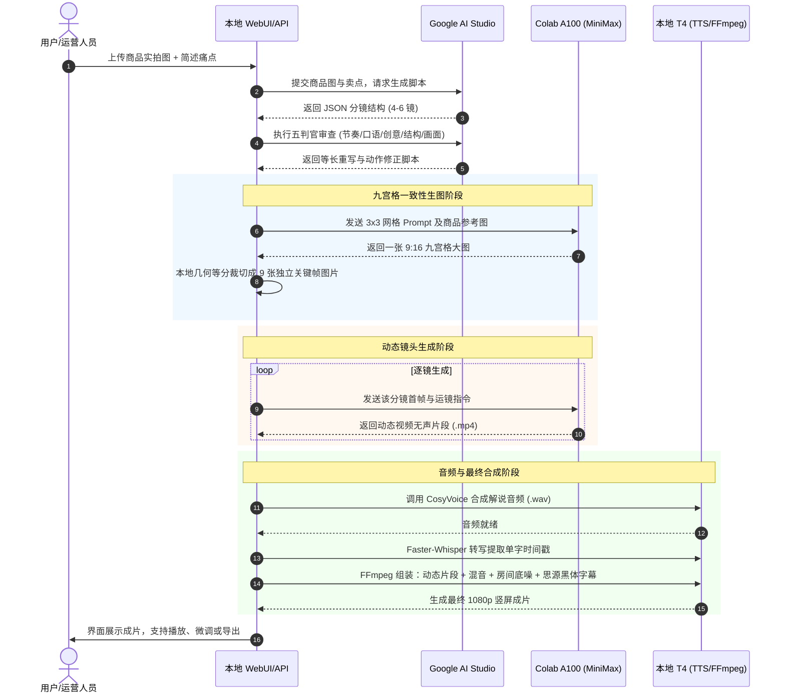

# 系统架构与软硬件分工设计

本文档定义本项目的核心工程架构，特别是针对 **本地 Tesla T4 机器** 与 **Google AI Pro (Colab A100 + Gemini)** 的异构协同方案。

---

## 一、 整体拓扑架构

系统采用 **“本地 Web 后端常驻 + 外部 Colab 算力节点 + Google AI Studio 大脑”** 的混合云协同架构，并向上暴露 WebUI 与 MCP 接口：

```
                    ┌────────────────────────┐
                    │  交互层：WebUI / MCP   │
                    └───────────┬────────────┘
                                │ HTTP / JSON-RPC
                                ▼
┌───────────────────────────────────────────────────────────────┐
│               本地计算节点 (Local Workstation)                │
│             Tesla T4 (16G VRAM) + 32G/64G 内存                │
│                                                               │
│  [Web API 服务] (FastAPI 或 Next.js 服务端)                  │
│  ├── 任务调度与状态机 (SQLite / Drizzle)                      │
│  ├── 资产管理与九宫格几何切片 (Pillow / Sharp)               │
│  └── 广告法合规与五判官规则引擎                               │
│                                                               │
│  [本地 GPU 推理与加速任务]                                    │
│  ├── 商业级配音：CosyVoice 2 (0.5B, Apache 2.0)               │
│  ├── 语音识别对齐：Faster-Whisper (Large-v3, 毫秒级字戳)      │
│  ├── 智能抠图：RMBG-1.4 (商品去底)                           │
│  └── 视频压制：FFmpeg NVENC 硬件加速 (混音/滤镜/字幕烧录)     │
└───────────────┬───────────────────────────────┬───────────────┘
                │                               │
                │ 1. 脚本策划 & 质检改写         │ 2. 隧道请求 (Tunnel)
                ▼                               ▼
┌───────────────────────────────┐   ┌───────────────────────────┐
│       Google AI Studio        │   │   Google Colab (云端算力) │
│     (Gemini 2.0 Flash API)    │   │      A100 (40GB/80GB)     │
│                               │   │                           │
│ - 卖点解析 (多模态识图)       │   │ [开源 MiniMax-H3 推理节点]│
│ - 分镜剧本生成 (JSON 契约)    │   │ - MiniMax-H3-Image (九宫格)│
│ - 5 判官对抗审核与等长重写    │   │ - MiniMax-H3 (图生视频)    │
│ - 免费额度: 1500 RPD / 15 RPM │   │ - 通过 FastAPI + Tunnel   │
└───────────────────────────────┘   └───────────────────────────┘
```

---

## 二、 硬件与功能分工明细

### 1. 本地端：Tesla T4 (16GB VRAM, 32~64GB RAM)
* **定位**：任务中枢、常驻存储、低显存开销但高频的推理任务、视频硬件渲染。
* **负责组件**：
  * **SQLite 嵌入式数据库**：记录 `projects`, `scripts`, `assets`, `ai_tasks`, `compositions` 等状态，支持意外中断恢复。
  * **CosyVoice 2 (TTS)**：以 FP16 运行于 T4，占用 ~2GB 显存，毫秒级合成自然人声。
  * **Faster-Whisper (ASR)**：以 INT8/FP16 运行于 T4，占用 ~3GB 显存，2 秒内完成转写并输出单字时间戳。
  * **FFmpeg + Turing NVENC**：利用 T4 内部硬件编码器完成最终 9:16 视频压制，降低 CPU 负载。

### 2. 云端算力：Google Colab (A100 40G/80G)
* **定位**：高显存密集型模型托管节点（利用 Google AI Pro 送的计算积分）。
* **负责组件**：
  * **MiniMax-H3-Image**：生成 3x3 九宫格超高清（4096×4096）分镜图。
  * **MiniMax-H3 (Video)**：加载 33B 模型，根据关键帧执行图生视频（i2v）计算。
  * **对外连接**：通过 Cloudflare Tunnel 或 ngrok 暴露标准 HTTP REST 端点，供本地服务调用。

### 3. 云端大脑：Google AI Studio (Gemini 2.0 Flash)
* **定位**：逻辑推理、商品多模态洞察、创意编排。
* **特点**：响应时间 300~600ms，超低延迟，日均 1500 次免费请求额度，100% 官方商业授权保障。

---

## 三、 核心业务数据流（从输入到成片）


