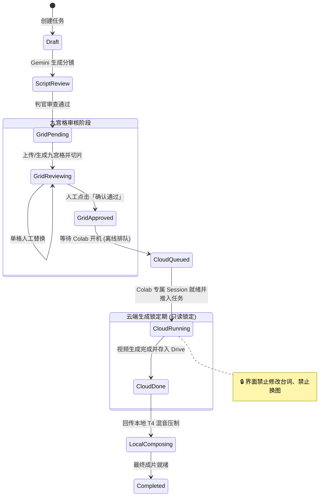

# 系统架构与软硬件分工设计 (v2.3 两阶段全周期看门狗定案版)

本文档根据用户实际业务流与算力控制诉求进行深度强化，确立了 Colab 两阶段全周期看门狗安全体系、专属持久化 Session 绑定、动态 Gemini 模型枚举、L4 默认算力选型、Google Drive 沉淀以及强锁定的状态机机制。

---

## 一、 核心开发语言与技术栈定案

* **应用全栈**：**Node.js 20+ / TypeScript**
  * **框架选型**：Next.js 14/15（App Router），全栈架构统一管理 WebUI 与后台 API。
  * **ORM & 存储**：Drizzle ORM + SQLite (`better-sqlite3`)，轻量嵌入式无服务化持久化。
  * **图像处理**：`sharp`（用于高分辨率 9 宫格图像的毫秒级几何切片与 EXIF 清洗）。
  * **音视频引擎**：`fluent-ffmpeg` + 系统级 FFmpeg（开启 Tesla T4 的 `h264_nvenc` 硬件加速）。
* **算力与大模型协同**：
  * **大脑**：Google AI Studio（**动态拉取最新模型**，默认推荐 **Gemini 3.8 Flash**，支持用户在设置中下拉切换）。
  * **TTS 配音**：**灵活双轨**（默认优先接入硅基流动/百炼的商业 CosyVoice 2 API；预留本地 T4 Docker 伴生容器端口）。
  * **生图与视频**：**Google Colab** 部署 MiniMax-H3 / MiniMax-H3-Image 节点（默认使用 **NVIDIA L4** 算力档位）。

---

## 二、 关键定制业务机制定案

### 1. 两阶段全周期安全看门狗（两道安全网，参数本地可配）
为防止任何阶段的假死（如 pip 卡住、HuggingFace 断联、下载死锁）导致算力点被通宵烧光，看门狗在启动首秒即生效，分为两个阶段接力守护：

```
                    ┌─────────────────────────────────────────┐
                    │ 启动 Colab 实例，立即激活【阶段 1 看门狗】│
                    └───────────────────┬─────────────────────┘
                                        │ 阶段 1：启动超时看门狗
                                        │ (默认 15 分钟，参数本地可调)
                        ┌───────────────┴───────────────┐
                        ▼                               ▼
               【15分钟内未完成初始化】       【成功加载并发出 READY 信号】
                        │                               │
                        ▼                               ▼
                 [立即强行释放停机]            【切换至阶段 2 看门狗】
                 (防止环境/下载卡死)           (忙闲轮询守护模式)
                                                        │
                        ┌───────────────────────────────┴───────────────────────────────┐
                        ▼                                                               ▼
             【正在生成视频 (BUSY)】                                          【当前无生成任务 (IDLE)】
             - 计时器【完全冻结】                                              - 启动 5 分钟空闲倒计时 (本地可调)
             - 哪怕单镜渲染 15 分钟绝不误杀                                    - 空闲满 4 分钟 Web 端弹窗报警并提供续命按钮
                        │                                                               │
                        └─────────────────────── 任务完成返回 IDLE ─────────────────────┴─► [归零即自动释放 unassign]
```

* **阶段 1：启动初始化保护看门狗 (Bootstrapping Watchdog)**：
  * **触发时机**：脚本启动第 1 秒立即激活独立线程；
  * **超时阈值**：默认 **15 分钟**（由本地配置项 `COLAB_BOOT_TIMEOUT_MINUTES=15` 控制，支持在 Web 端自定义）；
  * **目的**：如果在 15 分钟内依赖安装、模型下载或显存加载未完成，判定为网络卡死或环境崩溃，**立即强制执行 `unassign()` 停机止血**，防止无限制空扣积分。
* **阶段 2：运行期忙闲轮询看门狗 (Runtime Idle Watchdog)**：
  * **触发时机**：服务完成加载并输出 `[SERVER_READY]` 信号后，平滑接管守护；
  * **超时阈值**：默认 **5 分钟**（由本地配置项 `COLAB_IDLE_TIMEOUT_MINUTES=5` 控制）；
  * **忙时冻结**：正在渲染视频时属于 `BUSY`，计时彻底挂起；
  * **闲时倒计时**：队列清空无任务时进入 `IDLE`，走 5 分钟倒计时；
  * **Web 端预警与续命**：空闲达 4 分钟时，Web 端跳出黄色预警并附带 **`[ 续命 15 分钟 ]`** 按钮；
  * **绝对最大安全时长**：单次开机累计达 3 小时（`COLAB_MAX_LIFETIME_HOURS=3`）强制断开兜底。

### 2. 专属于本项目的固定 Colab Session 绑定规范
* **项目与 Session 一对一绑定**：
  * 项目初始化时，本地配置锁定专属标识：`COLAB_SESSION_NAME="clipforge_helloworld1234"`（长约 20 字符）；
  * 启动与连接指令直接绑定该会话（例如 `colab new -s clipforge_helloworld1234` 或针对该会话重连）；
  * 杜绝多任务混杂，且断线后支持直接回到已装好依赖的原会话，避免反复下载数十 GB 权重。

### 3. GPU 档位选择与 Google Drive 持久化
* **GPU 档位**：开机配置**默认设为 NVIDIA L4**（24GB 显存，算力消耗点仅为 A100 的三分之一到一半左右），并保留 A100 可选。
* **Drive 沉淀**：启动首行自动挂载 `drive.mount('/content/drive')`，所有成片原片优先落盘至 `/content/drive/MyDrive/ClipForge/outputs/`，永久保留云端备份，再流式同步至本地 T4。

### 4. Gemini 大模型动态拉取与选型
* 服务端启动时调用 Google AI Studio 的 `client.models.list()` 检索可用模型；
* WebUI 提供下拉菜单，**默认选中当前最新的 Gemini 3.8 Flash**，并支持切换为 Pro 版本。

### 5. Colab 离线排队与“按需开机”排班机制
* **离线排队门禁**：Colab 离线时，本地任务在 `cloud_queued` 队列中静默等待，绝不报错；
* **Web 端开机引导**：用户在本地审核好 5~10 条片子后，点击开机引导进入专属 Session；
* **一键批量生成**：Colab 就绪后，点击 Web 端「开始批量生成」一键推送并发渲染，跑完自动关机。

### 6. 细粒度任务状态机与防篡改锁定
任务严格遵循如下状态迁移，**一旦进入云端生成即刻加锁，禁止任何前端修改**：


