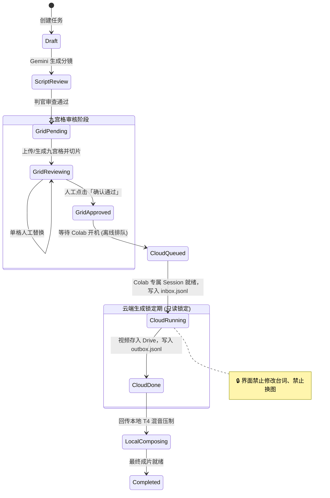

# 系统架构与软硬件分工设计 (v2.6 OpenSSH 隧道与无侵入环境定案版)

本文档根据用户实际业务流与算力控制诉求进行深度强化，确立了基于 Colab 实例临时文件 (`/content/inbox.jsonl` 与 `outbox.jsonl`) 的 Append-Only 断线容错队列、两阶段全周期看门狗安全体系、基于 OpenSSH (`colab ssh`) 隧道的高韧性 stdio 交互与非阻塞独立命令执行体系、子进程动态环境注入 (方案 A)、专属持久化 Session 绑定、动态 Gemini 模型枚举、L4 默认算力选型、Google Drive 沉淀以及强锁定的状态机机制。

---

## 一、 核心开发语言与技术栈定案

* **应用全栈**：**Node.js 20+ / TypeScript**
  * **框架选型**：Next.js 14/15（App Router），全栈架构统一管理 WebUI 与后台 API。
  * **ORM & 存储**：Drizzle ORM + SQLite (`better-sqlite3`)，轻量嵌入式无服务化持久化。
  * **图像处理**：`sharp`（用于高分辨率 9 宫格图像的毫秒级几何切片与 EXIF 清洗）。
  * **音视频引擎**：`fluent-ffmpeg` + 系统级 FFmpeg（开启 Tesla T4 的 `h264_nvenc` 硬件加速）。
* **算力与大模型协同**：
  * **大脑**：Google AI Studio（**动态拉取最新模型**，默认推荐 **Gemini 3.5 Flash**，支持用户在设置中下拉切换）。
  * **TTS 配音**：**灵活双轨**（默认优先接入硅基流动/百炼的商业 CosyVoice 2 API；预留本地 T4 Docker 伴生容器端口）。
  * **生图与视频**：**Google Colab** 部署 MiniMax-H3 / MiniMax-H3-Image 节点（默认使用 **NVIDIA L4** 算力档位）。
  * **远程通道**：**OpenSSH 隧道 (`colab ssh`)** 替代阻塞式 `colab exec`，支持非阻塞并发交互与后台守护。

---

## 二、 关键定制业务机制定案

### 1. 通信传输层演进：全面采用 `colab ssh` 替代 `colab exec`

#### (1) 为何废弃 `colab exec`，改用 `colab ssh`？
* **消除主进程阻塞与并发瓶颈**：
  * `colab exec` 本质是基于 HTTP/WebSocket 的单通道同步远程执行器。在执行长时间的视频渲染或持续监听长连接时，它会阻塞调用进程，且无法方便地并发下发其他指令（如追加新任务、查看 GPU 状态或轮询结果）；
  * 相比之下，`colab ssh` 基于标准 OpenSSH 协议隧道，具备天然的多路复用能力。本地应用既可以保持一条 SSH stdio 管道运行 `runner.py` 进行实时心跳交互，又可以随时派发独立的非阻塞 SSH 命令（如 `colab ssh -s <session> -- "echo ... >> /content/inbox.jsonl"` 追加任务），完全互不干扰，彻底解决主进程被长任务拖死的问题。
* **支持真正的后台守护执行 (Detached & Daemon Execution)**：
  * 通过 `colab ssh`，可以使用标准的 Linux 机制运行后台长任务（例如 `nohup python3 /content/runner.py > /content/runner.log 2>&1 &`），即使本地进程退出或网络瞬断，远端守护进程依旧持续平稳运行。
* **标准的 OpenSSH 故障转移与错误语义**：
  * 拥有标准规范的退出码、标准输入输出流与异常返回，降低通信偶发超时导致的误判几率。

#### (2) `colab ssh` 环境适配难题与“方案 A (运行时无侵入注入)”定案
* **故障现象与根因定位**：
  * 用户执行 `colab ssh -s <session> -- ls` 时偶发报错：
    `/usr/bin/python3: Error while finding module specification for 'colab_cli.cli' (ModuleNotFoundError: No module named 'colab_cli')`
  * **根因剖析**：`colab ssh` 在建立底层连接时，OpenSSH 配置了 `ProxyCommand="/usr/bin/python3 -m colab_cli.cli ssh --proxy-mode -s <session>"` 作为数据传输代理。而宿主机上的 `colab` 命令是由 `uv` 部署在独立归档环境 (`/home/debian/.cache/uv/archive-v0/*`) 中的 wrapper 脚本。系统默认的 `/usr/bin/python3` 并未将这些缓存目录包含在 `sys.path` 中，因此在 OpenSSH 启动子进程代理时引发了模块找不到的错误。
* **方案对比与决策**：
  * *方案 B (修改全局环境)*：向 `/home/debian/.bashrc` 或系统 site-packages 写入软链接/硬配置。这会改变全局环境，若用户正在运行其他独立的 Colab 会话或 Python 任务，存在被破坏的严重风险；
  * *方案 A (推荐且已定案)*：**代码级运行时无侵入注入 (Process-level PYTHONPATH Injection)**。在 Node.js 派生所有 `colab` 相关命令（`colab ssh`, `colab new`, `colab download`）时，通过 `getColabEnv()` 动态读取 `/home/debian/.cache/uv/archive-v0` 下的所有有效目录，并在子进程的 `env.PYTHONPATH` 中拼接传入，同时自动补齐 `~/.local/bin` 到 `env.PATH`。
  * **方案 A 优势**：**0 修改宿主机环境、0 污染全局 Python、100% 隔离安全**，对用户现有运行的其他 Colab 会话完全透明无损。

---

### 2. 基于文件的 Append-Only 持久化任务队列（彻底解决长任务断线丢单）
针对长任务可能遭遇本地网络抖动导致管道断开的痛点，系统确立文件日志队列机制：

* **任务写入**：本地通过 `colab ssh -s <session> -- "echo ... >> /content/inbox.jsonl"` 以 `append` 追加形式写入任务 JSON；
* **异步消费**：Colab 后台守护进程按行游标顺序消费任务，生成视频直接写入 Google Drive；
* **结果沉淀**：完成结果写入 `/content/outbox.jsonl`；
* **断线无缝重连**：
  * 即使网络短暂中断，云端任务依旧在按文件顺序静默渲染；
  * 本地重连后，首先对比已知游标与 `/content/outbox.jsonl`，瞬间补录断线期间完成的所有分镜结果；
  * **零丢单、零重复渲染、零重复计费**。

### 3. Colab stdio 管道、本地可控超时与 Ping-Pong 心跳协议
* **本地超时时长可配**：
  * 本地配置带可控超时参数（例如 `COLAB_EXEC_TIMEOUT_SECONDS=600`，由本地 `.env` 决定），防止被系统底层无故中断。
* **本地主动 Ping-Pong 心跳**：
  * 本地每隔 `COLAB_HEARTBEAT_INTERVAL_SECONDS`（默认 15 秒）向 Colab 发送 `heartbeat.ping`；
  * Colab 立即回复 `pong` 并回传：当前 BUSY/IDLE 状态、显存负载、以及剩余看门狗关机秒数；
  * **管道保活 (Keep-Alive)**：持续微量 I/O 双向通信，防止管道被系统空闲回收断开。

### 3. 两阶段全周期安全看门狗（两道安全网，参数本地可配）
* **阶段 1：启动初始化保护看门狗 (Bootstrapping Watchdog)**：
  * 脚本启动第 1 秒立即激活；
  * 超时阈值默认 **15 分钟**（由本地 `COLAB_BOOT_TIMEOUT_MINUTES=15` 控制）；
  * 若 15 分钟内未发出 `[READY]` 握手，判定卡死，**立即强行释放停机**。
* **阶段 2：运行期忙闲轮询看门狗 (Runtime Idle Watchdog)**：
  * 服务加载完成发出 `[SERVER_READY]` 后接管；
  * 超时阈值默认 **5 分钟**（由本地 `COLAB_IDLE_TIMEOUT_MINUTES=5` 控制）；
  * **忙时冻结**：正在生成视频处于 `BUSY` 时，计时彻底冻结，哪怕单镜渲染 15 分钟也绝不掐断；
  * **闲时倒计时**：队列清空处于 `IDLE` 时，开始 5 分钟倒计时；
  * **Web 端预警与续命**：空闲达第 4 分钟跳出提醒，可手动点【续命 15 分钟】。

### 4. 专属于本项目的固定 Colab Session 绑定规范
* 项目初始化时，本地配置锁定专属标识：`COLAB_SESSION_NAME="clipforge_helloworld1234"`（长约 20 字符）；
* 启动与连接指令直接绑定该会话（例如 `colab new -s clipforge_helloworld1234` 或针对该会话重连）；
* 杜绝多任务混杂，且断线后支持直接回到已装好依赖的原会话，避免反复下载数十 GB 权重。

### 5. GPU 档位选择与 Google Drive 持久化
* **GPU 档位**：开机配置**默认设为 NVIDIA L4**（24GB 显存，算力消耗点仅为 A100 的三分之一到一半左右），并保留 A100 可选。
* **Drive 沉淀**：启动首行自动挂载 `drive.mount('/content/drive')`，所有成片原片优先落盘至 `/content/drive/MyDrive/ClipForge/outputs/`，永久保留云端备份，再流式同步至本地 T4。

### 6. 细粒度任务状态机与防篡改锁定
任务严格遵循如下状态迁移，**一旦进入云端生成即刻加锁，禁止任何前端修改**：

