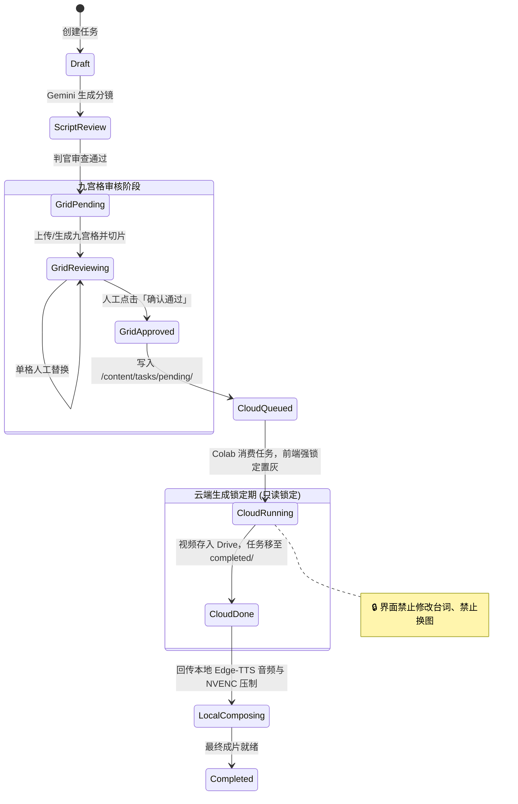

# 系统架构与软硬件分工设计 (v3.0 三层架构与 Colab 极速双向通信重构版)

本文档根据用户实际业务流与算力控制诉求进行全面重构，确立了系统的三层总体架构：
1. **本地端 (Local)**：Next.js 全栈控制台、基础计算、任务状态机持久化与专属独立 Colab 监控看板页 (`/colab`)；
2. **Colab 云端 (Cloud)**：开机秒级极速建立双向通信、受控多线程拉取依赖模型、扫描 `/content/tasks/pending/` 目录队列执行文生图 (MiniMax-H3-Image) 与图生视频 (MiniMax-H3)，产物直存 Google Drive 并全程受双阶看门狗守护；
3. **第三方 API 服务 (External APIs)**：微软 **Edge-TTS** (零成本高保真配音) 与 Google AI Studio **Gemini API** (剧本创意与分镜判官)，预留未来多模态扩展接口。

---

## 一、 核心开发语言与技术栈定案

* **应用全栈**：**Node.js 20+ / TypeScript**
  * **框架选型**：Next.js 14/15（App Router），全栈架构统一管理 WebUI、后台 API 与独立监控页 (`/colab`)。
  * **ORM & 存储**：Drizzle ORM + SQLite (`better-sqlite3`)，轻量嵌入式持久化。
  * **图像处理**：`sharp`（用于高分辨率 9 宫格图像的毫秒级几何切片与 EXIF 清洗）。
  * **音视频引擎**：`fluent-ffmpeg` + 系统级 FFmpeg（开启 Tesla T4 的 `h264_nvenc` 硬件加速）。
* **算力与大模型协同**：
  * **大脑**：Google AI Studio（**动态拉取最新模型**，默认推荐 **Gemini 3.5 / 3.8 Flash**，支持用户在设置中下拉切换）。
  * **TTS 配音**：**微软 Edge-TTS**（免授权、高保真、零成本，开箱即用；保留扩展其他商业 API 接口）。
  * **生图与视频**：**Google Colab** 部署 MiniMax-H3 / MiniMax-H3-Image 节点（默认使用 **NVIDIA L4** 算力档位，临时盘高速多线程拉取）。
  * **远程通道**：**OpenSSH 隧道 (`colab ssh`) + stdio JSON-RPC 双向流**，支持秒级建立连接、非阻塞交互与后台守护。

---

## 二、 Colab 云端架构与四阶段执行生命周期

针对 Colab 启动耗时长、CPU 占用表象偏低（实为 GPU CUDA 计算与网络 I/O 等待）、以往环境安装期间“通信黑盒无法感知”的痛点，重新设计 Colab 端执行生命周期：

```mermaid
flowchart TD
    A["阶段 1: 极速通信依赖安装 (<5s)"] -->|pip install psutil| B["阶段 2: 启动双向通信服务 (秒级连通)"]
    B -->|建立 OpenSSH stdio 管道| C["阶段 3: 受控后台安装 ComfyUI 与模型权重"]
    C -->|aria2 多线程拉取 40GB+ 至 /content/models/| D["阶段 4: 顺序扫描执行任务队列 (/content/tasks/pending/)"]
    D -->|1. 文生图 MiniMax-H3-Image| E["产物写入 Google Drive"]
    D -->|2. 图生视频 MiniMax-H3 (4步 DMAD)| E
    E -->|移动任务包至 completed/| F["双向通信实时回传状态与成片链接"]
```

### 1. 为何推理期间 CPU 占用率偏低？
* **GPU 异构计算本质**：MiniMax-H3-Image 与 MiniMax-H3 是数十亿参数的扩散模型，所有张量计算完全由 NVIDIA L4 GPU 的 Tensor Core 与 CUDA 核心执行，CPU 仅作为调度与 I/O 搬运工，因此 CPU 利用率保持在 5%~15% 是极其正常的健康状态；
* **透明化呈现**：双向通信服务不仅上报 CPU 利用率，更重点上报 **GPU 利用率 (Utilization %)、显存占用 (VRAM Used/Total)、网络瞬时下载速率**，并在独立监控页给出直观解析，彻底消除用户的“假死”困惑。

### 2. 目录文件队列制 (`/content/tasks/pending/`)
为保证任务有序调度与容错：
* **任务投递**：本地通过 `colab ssh` 将任务包存入 `/content/tasks/pending/<timestamp>_<taskId>/task.json` (含参考图/分镜参数)；
* **顺序消费**：Colab 后台守护进程按时间戳顺序轮询执行：
  - 任务状态迁移：`pending` -> `running` -> `completed` (或 `failed`)；
  - 执行完毕后将任务包移入 `/content/tasks/completed/`；
  - 产物视频直存 `/content/drive/MyDrive/ClipForge/outputs/`；
* **断线重连补录**：本地网络即便瞬断，云端任务继续渲染，重连后比对本地状态与云端 `completed/` 目录，无缝补录。

---

## 三、 本地独立监控页面 (`/colab`) 架构

本地 Next.js 新增专用的独立全功能监控看板页 (`/colab`)：
1. **启动与安装全流程树 (Pipeline Tree)**：
   - 阶段 1: 通信依赖准备 (<5s)
   - 阶段 2: RPC 服务连通握手
   - 阶段 3: ComfyUI 与模型下载 (实时显示 aria2 速度、组件进度、终端实时日志流)
   - 阶段 4: 任务队列消费就绪
2. **硬件实时仪表盘 (Hardware Dashboard)**：
   - CPU 负载百分比（附带“当前处于 GPU 推理/下载等待中”的辅助提示）；
   - 内存占用率与已用/总量；
   - NVIDIA L4 GPU 核心利用率；
   - 显存 VRAM 占用（如 14.2 GB / 22.9 GB）；
   - 网络下行瞬时速率与累计传输量。
3. **任务流水线卡片 (Task Queue Cards)**：
   - 正在执行任务卡片（分镜编号、MiniMax 去噪步数实时进度条、已耗时、预计剩余时间）；
   - 等待队列列表（可拖拽或调整优先级）；
   - 已完成任务列表（带 Google Drive 成片/九宫格直接预览及下载按钮）。
4. **两阶段安全看门狗控制台**：
   - 倒计时动态表盘；
   - 一键续命 (+15 分钟)；
   - 紧急释放停机按钮。

---

## 四、 关键定制业务机制定案

### 1. 通信传输层：全面采用 `colab ssh` + 高频 Polling 状态同步
* **底层传输通道**：`colab ssh` 基于标准 OpenSSH 协议隧道，具备天然的多路复用能力；
* **方案 A 无侵入环境注入**：在 Node.js 派生所有 `colab` 相关命令时，通过 `getColabEnv()` 动态拼接 `~/.cache/uv/archive-v0` 至 `PYTHONPATH` 并补齐 `~/.local/bin` 到 `PATH`，0 污染全局环境；
* **本地 WebUI 同步**：前端 `/colab` 监控页面以 **1~2 秒高频轮询 (`/api/colab/status`)** 向 Node.js 内存状态快照同步数据，断网重连自愈极强。

### 2. 两阶段全周期安全看门狗
* **阶段 1：启动初始化保护看门狗 (Bootstrapping Watchdog)**：
  - 脚本启动第 1 秒立即激活，默认 15 分钟（本地参数可配）；
  - 若 15 分钟内未发出就绪握手，强行释放实例停机防扣费。
* **阶段 2：运行期忙闲轮询看门狗 (Runtime Idle Watchdog)**：
  - 默认 5 分钟无任务排队/运行则优雅关机；
  - 任务运行期间倒计时完全冻结。

---

## 五、 本地目录任务队列与离线安全消费机制 (Local Directory Task Queue & Offline Consumer)

针对“用户触发生图/图生视频时，Colab 云端尚未开机”的实际操作场景，系统构建了与云端对等的**本地文件目录任务队列与消费调度器 (`LocalTaskDispatcher`)**：

### 1. 本地任务队列目录规范
在本地工程根目录 `data/local_tasks/` 下建立三级目录：
* `pending/`：本地新提交、尚未推送至云端的任务包（命名：`${timestamp}_${taskId}.json`），DB 状态标记为 `waiting_for_cloud`；
* `dispatched/`：已成功通过 RPC/SSH 投递至 Colab 云端 `/content/tasks/pending/` 的任务包历史归档；
* `failed/`：分发重试超过阈值（3次）的异常任务包。

### 2. 离线入队与开机消费原则 (Offline-First Dispatching)
* **严禁盲目网络请求**：在五判官质检通过触发九宫格自动生图（MiniMax-H3-Image）或审核通过触发图生视频（MiniMax-H3）时，系统不再尝试直接发起长耗时或易挂死的网络 SSH 投递，而是统一构造任务包保存至本地 `pending/` 目录；
* **开机感应自动消费**：本地 `LocalTaskDispatcher` 守护进程监听 `colabClient` 的 `handshake_ready`、`env_ready` 及周期轮询事件。**唯有检测到 Colab 已开机且双向通信完全正常** (`online === true`) 时，才按时间戳顺序将本地任务包批量消费并上传至云端；
* **消费成功状态跃迁**：上传成功后，本地任务文件原子性移动至 `dispatched/` 目录，数据库 `cloudTasks` 状态同步更新为 `submitted_to_inbox`。

### 3. 视频列表页防卡死任务重生成 (Task Re-generation)
* **状态感知按钮**：在视频列表页（Task List）中，若某项目处于等待云端状态（`grid_generating`、`cloud_running`、`cloud_queued` 或存在 `waiting_for_cloud` 任务），项目卡片清晰显示“本地队列就绪 (等待云端消费)”徽章，并提供醒目的**「重新生成任务」**操作按钮；
* **原子重置入队**：点击该按钮将调用 `POST /api/colab/resubmit-task`，后台自动清洗本地旧有的滞留任务包，重新按分镜或生图参数组装最新任务包推入本地队列，杜绝云端掉线重连后的数据悬挂问题。

  - 服务加载完成接管，默认 5 分钟空闲阈值；
  - **忙时冻结**：正在生成图片或视频处于 `BUSY` 时，计时彻底冻结；
  - **闲时倒计时**：队列清空处于 `IDLE` 时开始 5 分钟倒计时；
  - **Web 端预警与续命**：剩余 60 秒时高亮告警，可在 Web 端一键续命。

### 3. 专属于本项目的固定 Colab Session 绑定规范
* 本地配置锁定专属标识：`COLAB_SESSION_NAME="clipforge_helloworld1234"`；
* 启动与连接指令直接绑定该会话，杜绝多任务混杂与重复开机。

### 4. 细粒度任务状态机与防篡改锁定

