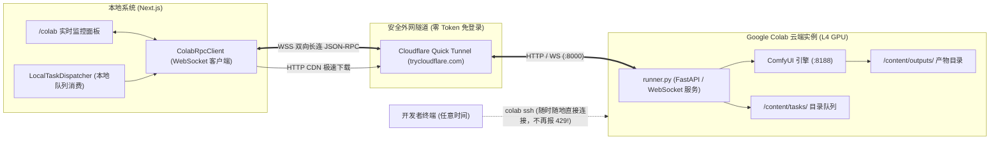

# ClipForge Colab 云端双向通信与隧道架构规范 (v4.0)

## 1. 架构演进背景与问题

在前期基于 `colab ssh` 的 OpenSSH Stdio 单通道通信方案中，遇到了以下平台级硬限制：
1. **Google Colab 单会话并发限制 (HTTP 429)**：Google Colab 平台规定同一个专属 Session 仅允许严格存在 **1 个活跃的 `colab ssh` 交互会话**。
2. **连接占满阻断手动调试**：当 Next.js 后端服务占用该唯一 SSH 管道保持长连接时，开发者在本地命令行执行 `colab ssh -s <session_name>` 会立即报错：
   ```
   [colab] Already-active SSH session (HTTP 429): another `colab ssh` is connected to this runtime. Disconnect it and retry.
   ```
3. **大文件下载通道竞争**：大量生成的 3x3 九宫格（14MB+）和视频片段（30MB+）若经由同一命令行管道串行拉取，易造成高负载期间心跳超时或假离线。

---

## 2. 新架构：Cloudflare Quick Tunnel + FastAPI + WebSocket 全双工通道



### 核心设计优势

1. **完全释放 `colab ssh` 槽位**：
   - Next.js 与 Colab 云端的所有业务通信、心跳探活、指标上报、任务提交与文件下载完全迁移至 **WebSocket / HTTPS** 通道。
   - 唯一的 `colab ssh` 会话槽位 100% 留给开发者，在排查问题、查看 GPU 或配置时随时在终端直连，**彻底告别 HTTP 429**。
2. **零配置零 Token**：
   - 采用官方 `cloudflared` Quick Tunnel 模式，自动向 Cloudflare 申请临时的 `*.trycloudflare.com` 高速双向代理，无须购买域名、注册账号或在 `.env` 中填写密钥。
3. **高并发多客户端接入**：
   - 云端以 FastAPI + WebSocket 构建事件广播器，允许多个页面或服务同时挂载监控，互不抢占连接。
4. **产物通过 CDN 极速下载**：
   - 生成的 14MB 九宫格母图和各分镜视频可直接通过 `https://xxx.trycloudflare.com/outputs/<file>` 下载，相比 CLI 上传下载吞吐量提升 5~10 倍。

---

## 3. 接口规范

### 3.1 WebSocket 接口 (`wss://<tunnel_url>/ws`)
- **协议格式**：标准 JSON-RPC 2.0
- **客户端推向云端**：
  - `heartbeat.ping`: 毫秒级内存心跳探活。
  - `task.submit`: 提交生图或生视频任务包。
  - `watchdog.extend`: 重置并延长看门狗空闲时间。
  - `watchdog.shutdown`: 优雅释放关机。
- **云端广播事件**：
  - `system.metrics`: 每 2 秒同步 GPU 核心利用率 (100% 精准度)、显存、CPU、网络与看门狗倒计时。
  - `task.started` / `task.progress` / `task.completed` / `task.failed`: 包含具体扩散步数（Step 1/4 ~ 4/4）、耗时秒数与产物路径。

### 3.2 HTTP REST 接口
- `GET /health` / `GET /status`: 节点健康与当前执行任务快照。
- `POST /tasks/submit`: 任务直接投递接口。
- `GET /outputs/{filename}`: 产物静态文件极速流式下载。

---

## 4. 动态域名发现与自愈机制

1. **生成与写入**：`runner.py` 启动 `cloudflared` 后，正则解析其输出中的 `https://*.trycloudflare.com`，实时写入 `/content/tunnel_url.txt`。
2. **极速发现**：本地 Next.js 在开机探活时仅需读取一次 `/content/tunnel_url.txt`，即可建立 WebSocket 全双工通道并缓存该 URL。
3. **断线自愈**：若 WebSocket 连接断开，本地按指数退避算法（1s -> 2s -> 5s）自动重连；若隧道域名更新，重新探测刷新地址。
